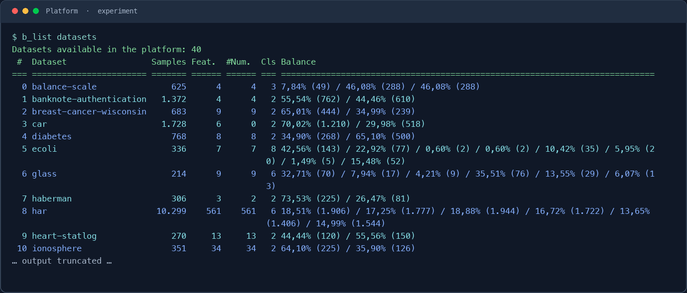
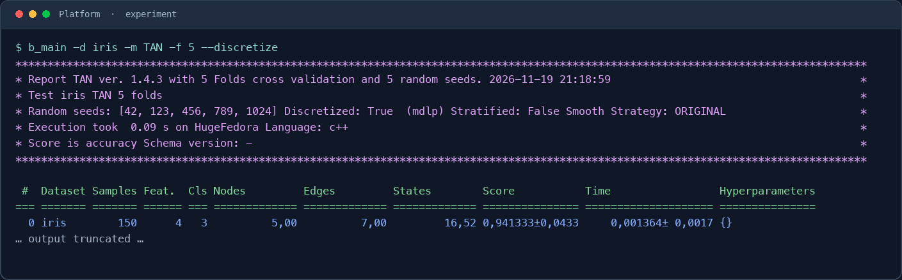
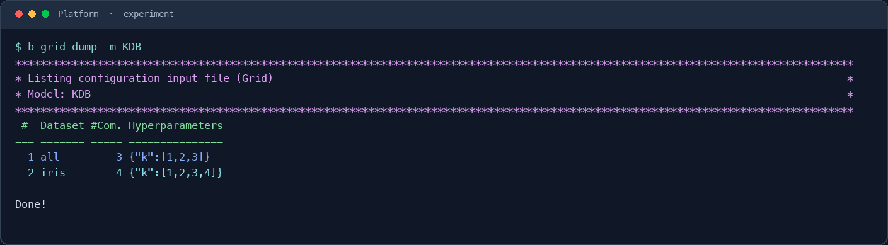
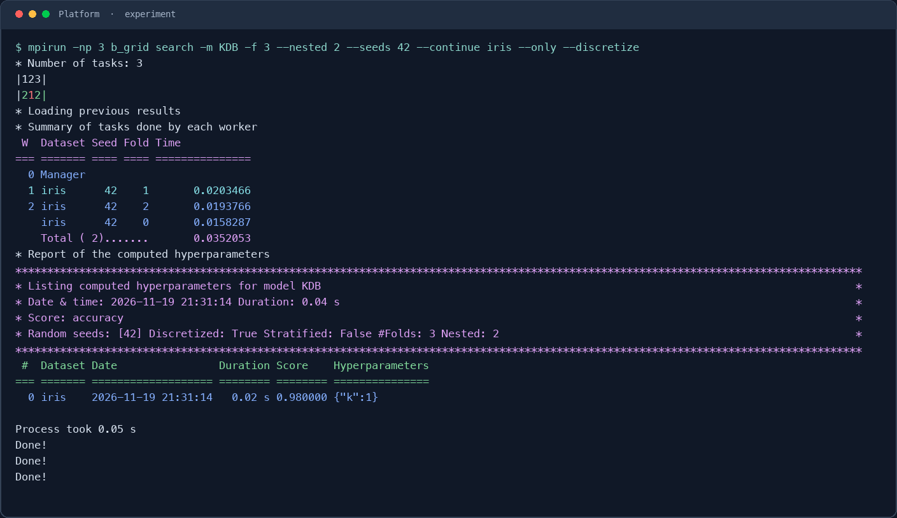
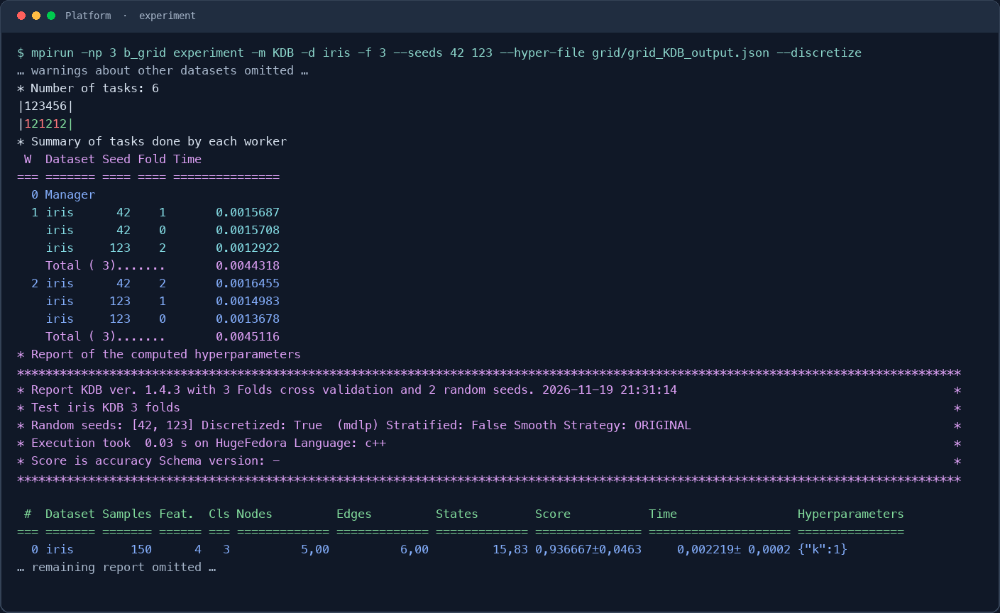
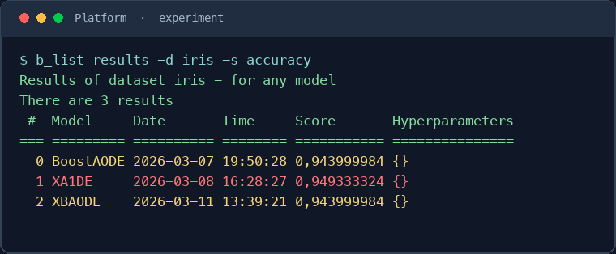
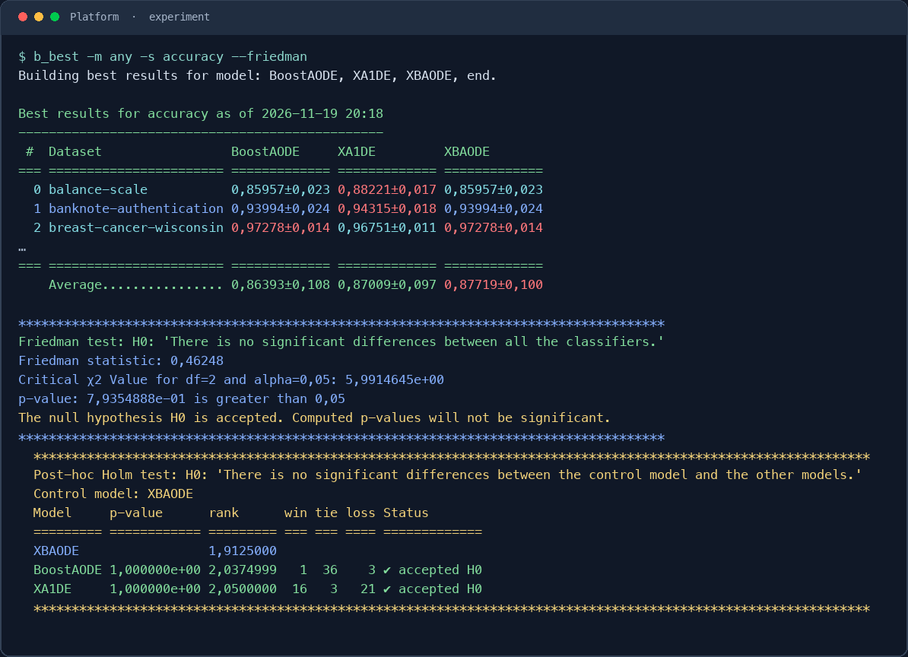
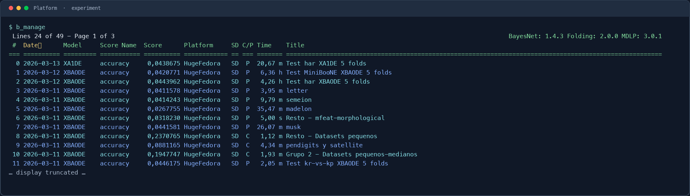
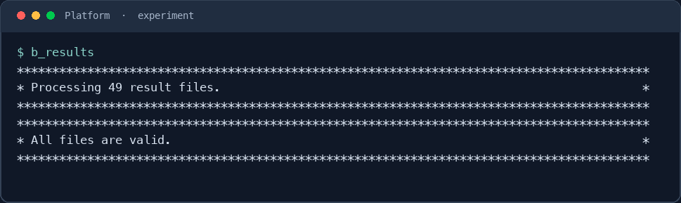

#  Platform


[](https://opensource.org/licenses/MIT)
[](https://deepwiki.com/rmontanana/Platform)


Platform is a C++ framework for running and comparing machine-learning experiments, with a focus on Bayesian network classifiers. It brings datasets, cross-validation, hyperparameter search and result analysis together in a set of command-line tools.

- Run classification experiments with configurable folds, seeds and preprocessing.
- Search hyperparameters in parallel with MPI.
- Browse, compare and validate results, and export reports to Excel or TeX.
- Use Bayesian network classifiers alongside supported Python-based models.

## At a glance

The following terminal images were rendered from actual command output using an experiment directory with 42 datasets and 49 result files. The dataset listing is shortened for readability.

### Explore datasets

`b_list datasets` displays the available datasets, their sizes, features, classes and class balance.



### Run an experiment

`b_main -d iris -m TAN -f 5 --discretize` trains and evaluates TAN with five-fold cross-validation. The report below is an excerpt of the output, using the experiment's configured random seeds.



### Explore a hyperparameter grid

`b_grid dump -m KDB` displays the combinations in `grid/grid_KDB_input.json` before running a search. This example uses a sample grid with `k` values for all datasets and a separate set for iris; see the [grid guide](docs/b_grid.md) for the input format and MPI search commands.



### Search hyperparameters with MPI

`b_grid search` distributes the cross-validation tasks across MPI workers. Here, three MPI processes search the sample grid for iris; `--continue iris --only` selects that dataset and loads any previous search results. The table shows the work completed by each worker and the winning hyperparameters.



### Run a parallel experiment

`b_grid experiment` runs the experiment across MPI workers. This example uses the hyperparameters produced by the search above, with three folds and two seeds. Warnings about other datasets and the remainder of the report have been omitted from the image.



### Compare results

`b_list results -d iris -s accuracy` shows the recorded results for a dataset.



`b_best -m any -s accuracy --friedman` compares the best recorded score for each model and dataset, followed by the Friedman test and the Holm post-hoc test. The image omits some dataset rows to show both the table header and the statistical results; the command also updates the corresponding best-results files.



### Browse experiments interactively

`b_manage` opens a terminal interface for browsing and filtering results. From the list, use `r` with a row number to inspect a result or `q` to quit.



### Validate results

`b_results` checks the result files against the expected schema.



## Installation

Platform uses CMake and Make, with dependencies managed by Conan. You need a C++20 compiler, CMake, Make, Conan, MPI and Boost. Miniconda is also needed for Python-based classifiers.

```bash
make init       # install dependencies for Debug and Release
make release    # build in build_Release/
# or: make debug
```

Executables are placed in `build_Release/src/` or `build_Debug/src/`. To install them in `~/bin`, use `make install`.

See the [installation guide](docs/installation.md) for platform-specific prerequisites, optional dependencies and troubleshooting.

## Quick start

Run the commands from your experiment directory: Platform reads its `.env` configuration from the current working directory. Start with the repository's [.env.example](.env.example), prepare your datasets and their `all.txt` index, and create the required directories as described in the [configuration guide](docs/configuration.md).

```bash
cd /path/to/experiment

# Inspect your datasets
b_list datasets

# Run a five-fold experiment on iris
b_main -d iris -m TAN -f 5

# Inspect recorded results and validate their files
b_list results -d iris -s accuracy
b_results
```

The examples assume the executables are on your `PATH`. Running an experiment writes results to the configured experiment directory.

## Commands

| Command | Purpose | Guide |
| --- | --- | --- |
| `b_list` | List datasets and inspect results for a dataset. | [b_list](docs/b_list.md) |
| `b_main` | Run cross-validated classification experiments. | [b_main](docs/b_main.md) |
| `b_grid` | Search hyperparameters and run experiments using MPI. | [b_grid](docs/b_grid.md) |
| `b_best` | Compare best results and generate statistical reports. | [b_best](docs/b_best.md) |
| `b_manage` | Browse and manage results in an interactive terminal interface. | [b_manage](docs/b_manage.md) |
| `b_results` | Validate result files and optionally repair them. | [b_results](docs/b_results.md) |

Use `--help` with a command for its options. The [user manual](docs/README.md) also covers [classifiers](docs/classifiers.md), [result formats](docs/results-format.md) and [troubleshooting](docs/troubleshooting.md).

## Tests

```bash
make test                     # build Debug and run the tests
make test opt="-s"            # verbose output
make test opt="-c='Test Name'" # run a specific section
make coverage                 # generate a coverage report
```

## License

Platform is distributed under the [MIT License](LICENSE).
